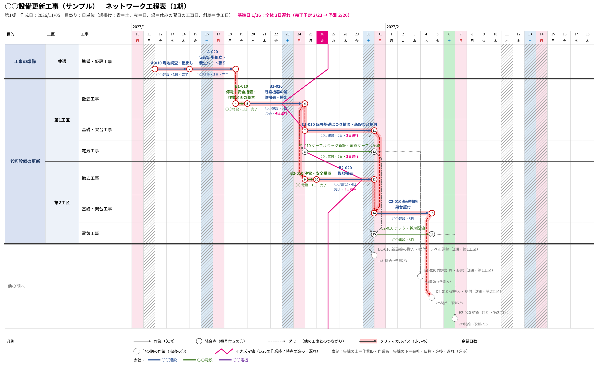

# networkproject

工事のネットワーク工程表（横軸＝日程、縦軸＝目的・工区・工事）を Excel で作るマクロです。
シェアウェアは使わず、Excel と VBA だけで動きます。取引先には PDF で渡します。

## ファイル

| ファイル | 中身 |
|---|---|
| `NetworkSchedule.bas` | マクロ本体（VBA）。Shift_JIS・改行 CRLF |
| `ネットワーク工程表_サンプル.xlsx` | 入力のサンプル（工程データ・設定・工事カレンダー・会社の色・使い方） |
| `images/` | 完成イメージ（マクロと同じ計算を Python でして描いたプレビュー。Excel では文字の大きさなどが少し違う） |

## 取り込み方

1. サンプル（または自分のブック）を開き、「名前を付けて保存」で「Excel マクロ有効ブック（*.xlsm）」にする
2. Alt+F11 で VBA の画面を開く。前の版の `NetworkSchedule` があれば、右クリック →「NetworkSchedule の解放」で外しておく（エクスポートは「いいえ」）
3. 「ファイル」→「ファイルのインポート」で `NetworkSchedule.bas` を選ぶ
4. Alt+F8 で `DrawNetworkSchedule` を実行すると、工程表のシートができる。PDF にするときは `ExportSchedulePdf`

入力の仕方や表示の見方は、サンプルの「使い方」シートにまとめてあります。

## 注意

- `.bas` は Shift_JIS・改行 CRLF のまま取り込む必要があります。GitHub の画面では日本語が文字化けして見えますが、中身は正しいです。ブラウザで編集すると壊れるので、編集しないでください（`.gitattributes` で改行の変換を止めています）
- このリポジトリは公開されています。実際の工事の工程データ（会社名・日程など）は入れないでください

## 開発

マクロの元は `src/NetworkSchedule.vba`（UTF-8）です。編集したら `python tools/build_bas.py` でチェックしてから
`NetworkSchedule.bas`（Shift_JIS・CRLF）を作ります。Claude Code で続けるときの決めごとは [CLAUDE.md](CLAUDE.md) にあります。

## 版

| 版 | 主な変更 |
|---|---|
| v11 | 工事カレンダー（曜日ごとの ○×、連休などの例外の日）で休工日を決める。土＝青・日＝赤・休みの曜日の工事日＝緑の網掛けと休工日の斜線。日数・余裕は工事する日で数え、休工日をはさむ矢線は次の工事日まで伸ばす。週単位の目盛りに日の区切りの点線。期ごとの目盛りの「日」は長くても日単位。サンプルの工程データを Excel のテーブルに。印刷は余白0・すべての行を1ページ、タイトル列（目的・工区・工事）とタイトル行（表題・目盛り）、ページ番号は右上 |
| v10 | 縦軸に「目的」の列（工区の左）。目的 → 工区 → 工事の3段で、同じ工区でも目的が違えば分けて並べる。まとめも目的ごと |
| v9 | 大きな工程表で止まりにくく：作図中に進み具合を表示（Esc で中止）、目盛りの「自動」（長い期間は週単位）、目盛りをまとめて描く、シートごとにかかった時間と図形の数を表示 |
| v8 | 実績の記入と遅れ：イナズマ線、矢線の下に「n日遅れ／進み」、全体の完了予測、工程データに予定進捗・予測終了など |
| v7 | 工程表の上で ○ を動かすと、工程データの開始・終了・日数に反映（後に続く作業もずらせる） |
| v6 | 工程表の上で作業をクリックして、先行作業をつなぐ・外す |
| v5 | 長い作業名を折り返す（隣の矢線と重ならない）、表示名、日付の罫線 |
| v4 | 工区ごとにまとめた縦軸 |
